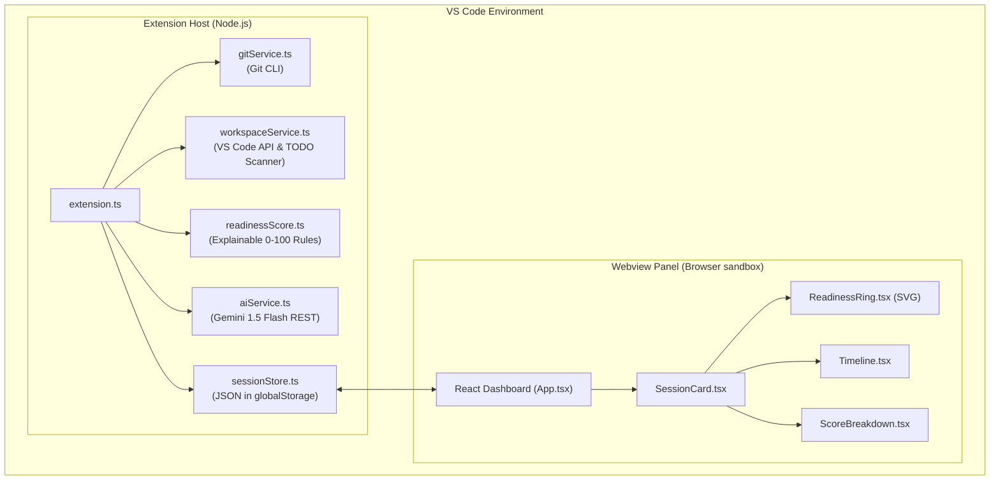

# ContextSwitch AI

> **Your coding session, remembered. Your momentum, restored.**

Built at **DevF8rge — Hacktoberfest 2026 Hack Day**, Bengaluru (MLH + Newton School of Technology).  
**Theme:** Developer Productivity — Ship tools that save developers time and frustration.

---

## ⚡ The Problem

Developers switch contexts constantly between meetings, Slack alerts, bug reports, and code reviews. When returning to their code, they lose **15 to 30 minutes** answering:
- *What was I debugging right before I got interrupted?*
- *Which files did I touch and what approach failed?*
- *What was the exact next thing I planned to do?*

Context is scattered across ephemeral terminal sessions, unstaged git diffs, open tabs, and human memory.

## 🚀 The Solution: ContextSwitch AI

**ContextSwitch AI** is a lightweight, zero-backend VS Code extension that captures deep coding-session context into structured checkpoints. When you return, it restores your workspace and momentum in one click.

---

## ✨ Features

- **⚡ Instant Context Capture (`Cmd+Shift+S` / `Ctrl+Shift+S`)**: Captures current branch, modified files, diff statistics, recent commits, active editor file, and user notes.
- **🎯 Explainable Resume Readiness Score (0–100)**: A transparent, rule-based scoring engine that grades how easy it will be to resume this session later.
- **✨ AI Session Summaries (Gemini 1.5 Flash)**: Generates concise 3-sentence executive summaries of your progress and blockers. Runs purely client-side; gracefully degrades to 100% offline mode if no key is configured.
- **▶️ One-Click Workspace Resume**: Reopens the relevant source files you were editing, resets your task context, and displays the exact next action to take.
- **📊 Developer Dashboard**: Dark-mode VS Code webview panel displaying session cards, animated SVG readiness rings, timeline events, search, and status filters.
- **🔔 Live Status Bar Indicator**: Live status bar widget at the bottom of VS Code showing active session progress and session count.
- **🔒 Privacy First**: Never scans secrets, credentials, or `.env` files. All session data is stored locally in your VS Code extension storage.

---

## 🏗️ Architecture



---

## 🎯 Resume Readiness Score Breakdown

The readiness score is **100% transparent and rule-based** — no arbitrary AI hallucinated scores:

| Check | Points | Rule Reason |
|---|:---:|---|
| **Task Description** | 25 | Is the core intent clearly articulated (>10 chars)? |
| **Modified Files** | 20 | Are modified and untracked files recorded? |
| **Last Known Problem** | 20 | Is the current blocker or failing error documented? |
| **Next Action Defined** | 20 | Is the immediate next step clear for when you return? |
| **Validation Status** | 10 | Are test / build statuses known? |
| **Feature Branch** | 5 | Is work on a dedicated branch rather than `main`/`master`? |
| **Total** | **100** | **Sum of all validated rules** |

---

## 🛠️ Setup & Running

### Prerequisites
- Node.js 18+
- npm 9+
- VS Code 1.85+
- Git

### 1. Clone & Build
```bash
git clone https://github.com/twi-ni/contextswitch.git
cd contextswitch
npm install
npm run build
```

### 2. Run Extension
Open the `contextswitch` folder in VS Code and press **`F5`** (or go to **Run and Debug** -> **Run Extension**). A new Extension Development Host window will open.

### 3. One-Command Live Demo (For Hackathon Judges)
Never rely on random luck or live network during a 2-minute demo:
```bash
./demo/run-demo.sh
```
This builds the extension and seeds realistic, high-fidelity sample sessions directly into your local VS Code global storage!

---

## ⌨️ Usage & Keybindings

| Command | Shortcut | Description |
|---|---|---|
| `ContextSwitch: Save Checkpoint` | `Cmd+Shift+S` (Mac) / `Ctrl+Shift+S` (Win/Linux) | Prompt 4 quick fields and snapshot session |
| `ContextSwitch: Open Dashboard` | Command Palette (`Cmd+Shift+P`) | Open interactive React dashboard |
| **Resume Session** | Click button in Dashboard | Automatically restores files and context |

---

## 🤖 AI Tools Disclosure

In strict accordance with DevF8rge Hackathon rules:
- **During Development**: Pair-programmed with [Antigravity (Google DeepMind)](https://antigravity.dev) and Claude for architecture verification.
- **In Product Runtime**: Integrated [Gemini 1.5 Flash](https://aistudio.google.com) via Google AI Studio free tier for generating optional natural language session recaps. The core product functions 100% offline without any API key.

---

## 🔒 Privacy & Security

- Zero telemetry tracking.
- All checkpoints persist purely on the user's local disk in VS Code's `globalStoragePath`.
- Git information collection ignores `.env` files, `.git/`, and binary blobs.

---

## 📜 Licence

Distributed under the **MIT License**. See [LICENSE](./LICENSE) for details.

## 🤝 Acknowledgements

See [CREDITS.md](./CREDITS.md) for full breakdown of all third-party libraries and frameworks.
Built with ❤️ for DevF8rge 2026.
